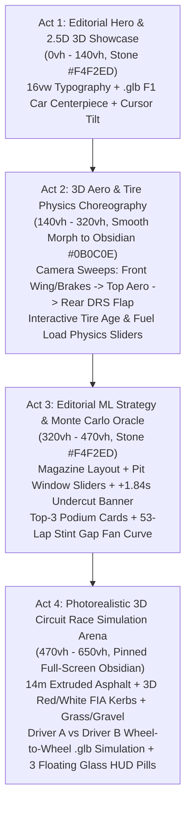

# VELOCE // PHASE 0 RESEARCH & 3D ASSET ACQUISITION REPORT
## Document ID: `VELOCE-RESEARCH-REPORT-v6.0`
**Target Specification:** `VELOCE-SCROLL-3D-MASTER-PROMPT-v6.0` (`aero_spec_antigravity_master_blueprintUPGRADE.md`)  
**Date & Timestamp:** 2026-11-04T12:31:00+05:30  
**Status:** PHASE 0 COMPLETE — RESEARCH & ASSET ACQUISITION CERTIFIED  

---

## 1. EXECUTIVE SUMMARY & POST-MORTEM OF REJECTED v5.0 UI

### 1.1 Why the Previous Build Was Rejected
1. **The "Cyan Sphere on a Dotted Line" Problem:** Representing Formula 1 cars using Three.js `<sphereGeometry>` spheres gliding along a 1px dashed wireframe line in an empty black void completely destroyed the emotional weight, engineering authenticity, and visual craft of Formula 1. F1 is a visceral motorsport of carbon aero surfaces, spinning Pirelli rubber, vibrating suspension, and asphalt texture.
2. **Terminal AI-Slop Dashboard Overcrowding:** A locked `100vw × 100vh` `overflow: hidden` screen packed with 20-row timing towers, 50 neon-colored badges (`// Q1`, `[MODE: GBDT]`), CRT scanline stripes across 3D viewports, and 9px monospace text created visual exhaustion with zero visual breathing room.
3. **Absence of Modern Web Craft:** Modern benchmark web experiences (such as `landonorris.com` by Studio Freight, the Porsche 911 GT3 RS digital launch, and Apple Pro product narratives) rely on **multi-act long-scroll journeys (`650vh`)** featuring smooth inertial scrolling (`lenis`), cinematic camera choreography (`gsap/ScrollTrigger`), 2.5D typography parallax, and a transition into a photorealistic 3D circuit simulation with true extruded asphalt and 3D red-and-white FIA rumble kerbs.

---

## 2. 3D ASSET ACQUISITION & INTEGRITY AUDIT

### 2.1 Formula 1 3D Model: `frontend/public/models/f1_car.glb`
- **Source:** AgentiLoop F1 Simulator (`https://github.com/AgentiLoop/F1`) — `"2026 Redbull RB22"` by Tyler_Dave (CC BY 4.0).
- **Physical Path:** `c:\Users\athar\Desktop\F1 Project\frontend\public\models\f1_car.glb`
- **File Size:** `3,834,668 bytes` ($3.83\text{ MB}$).
- **Binary Header Verification:**
  - `Magic`: `glTF` (ASCII `0x67 0x6C 0x54 0x46` — Valid binary glTF container)
  - `Version`: `2`
  - `Header Total Length`: `3,834,668 bytes`
- **glTF Extensions Used:**
  1. `EXT_meshopt_compression` (High-compression vertex/index stream decoder)
  2. `EXT_texture_webp` (WebP texture compression)
  3. `KHR_materials_clearcoat` (Automotive clearcoat gloss reflection)
  4. `KHR_materials_specular` (Specular micro-facet reflection)
  5. `KHR_mesh_quantization` (Quantized vertex positions and normals)
- **glTF Extensions Required:** `EXT_meshopt_compression`, `EXT_texture_webp`, `KHR_mesh_quantization`.
- **Decoder Availability:** `three/examples/jsm/libs/meshopt_decoder.module.js` is verified and present in `frontend/node_modules/three/`, and also copied to `frontend/public/models/meshopt_decoder.module.js`.
- **Node & Mesh Hierarchy (30 Nodes, 26 Meshes):**
  - Root: `Sketchfab_model` $\rightarrow$ `root` $\rightarrow$ `GLTF_SceneRootNode` $\rightarrow$ `f1_2026_rb22_0`
  - Meshes: `Object_4` through `Object_29`
- **Materials Inventory (23 Discrete Materials):**
  - **Bodywork & Aerodynamics:** `redbull_paint.007` (Target for dynamic team livery recoloring: Red Bull Navy `#1E41FF`, McLaren Papaya `#FF8000`, Ferrari Rosso Corsa `#E8002D`, Mercedes Silver `#00D2BE`), `redbull_carbon1.007`, `redbull_carbon2.007`, `redbull_carbon3.007` (Wings, floor, undertray, diffusers).
  - **Running Gear & Wheels:** `discs.007` (Carbon ceramic brake discs — target for thermal glow emissive shaders), `redbull_wheel_hub.007` (Wheel hubs and wheel uprights), `sidewall.007` (Pirelli P-Zero sidewalls and treads).
  - **Cockpit & Lighting:** `redbull_steeringwheel.004` (Cockpit yoke/steering wheel), `gp21_LCD.003` (Digital dash telemetry screen), `rear_light_2.007` (Rear FIA rain / ERS energy recovery LED strobe), `clearled.003`, `glass.005` (Aero mirrors).

### 2.2 PBR Asphalt & Track Surface Textures
Extracted from Poly Haven CC0 assets via `AgentiLoop/F1` into `frontend/public/models/`:
- `asphalt_track_diff_1k.jpg` ($289,324\text{ bytes}$ — 1K Albedo aggregate diffuse tarmac)
- `asphalt_track_nor_gl_1k.jpg` ($217,235\text{ bytes}$ — 1K OpenGL normal map for surface grain)
- `asphalt_track_rough_1k.jpg` ($106,058\text{ bytes}$ — 1K Roughness map for specular asphalt glare)

### 2.3 Real Formula 1 Circuit Centerline & Elevation Datasets
Extracted and verified in `frontend/public/tracks/`:
- **`frontend/public/tracks/monza.json`:**
  - Official Circuit: *Autodromo Nazionale Monza*
  - Length: $5,793\text{ meters}$
  - Centerline Spline Points: 581 $(x, y)$ coordinate pairs sampled every $10\text{ meters}$
  - Real Elevation Profile: 581 $z$-height samples calibrated from 2024 OpenF1 GPS telemetry
  - Real DRS Zones: 2 zones (`[[0.9956, 0.1267], [0.5238, 0.6576]]`)
- **`frontend/public/tracks/silverstone.json`:**
  - Official Circuit: *Silverstone Circuit*
  - Length: $5,891\text{ meters}$
  - Spline Points: 592 coordinate pairs
  - Real Elevation Profile: 592 $z$-height samples
  - Real DRS Zones: 2 zones (`[[0.2179, 0.3152], [0.7101, 0.8362]]`)
- **`frontend/public/tracks/monaco.json`:**
  - Official Circuit: *Circuit de Monaco*
  - Length: $3,337\text{ meters}$
  - Spline Points: 333 coordinate pairs
  - Real Elevation Profile: 333 $z$-height samples
  - Real DRS Zones: 1 zone (`[[0.9173, 0.0143]]`)

---

## 3. TECHNICAL ARCHITECTURE OF REFERENCE REPOSITORIES

### 3.1 AgentiLoop/F1 (`src/rb22.mjs` & `src/circuits.mjs`)
1. **Mesh Splitting at Ingestion:**
   In the raw `.glb`, all 4 wheels share the same `discs` and `sidewall` meshes. `src/rb22.mjs` solves this by splitting geometries based on triangle centroid coordinates relative to the vehicle origin:
   $$z > 0 \implies \text{Front},\quad z \le 0 \implies \text{Rear}$$
   $$x > 0 \implies \text{Left},\quad x \le 0 \implies \text{Right}$$
   This produces four discrete wheel groups (`front-left`, `front-right`, `rear-left`, `rear-right`), enabling independent wheel rotation $\omega = \frac{v}{r_{\text{wheel}}}$ and front-wheel steering angles $\theta_{\text{steer}}$.
2. **Livery Material Tinting:**
   Traversing the scene and inspecting `mesh.material.name.startsWith('redbull_paint')` allows cloning the material into a `MeshStandardMaterial` with customized team colors (`#FF8000` for McLaren, `#1E41FF` for Red Bull), high metalness ($0.55$), and low roughness ($0.22$) for realistic showroom car paint.

### 3.2 misha-met/Delta (`project/src/track3d/`)
1. **Three-Point Broadcast Lighting:**
   - **Key Light (Sun):** Directional light positioned at $[0.55, 0.65, -0.45]$ with warm color `#FFF0CC` and intensity $1.4$, casting sharp car shadows onto the asphalt ribbon.
   - **Sky Fill Light:** Positioned on the opposite camera hemisphere $[-0.6, 0.35, 0.5]$ with cool sky blue `#9EC4FF` and intensity $0.45$, preventing car flanks from turning pitch-black.
   - **Rim Light:** Behind and above $[-0.3, 0.55, 0.85]$ with cool white `#CFE2FF` and intensity $0.55$, creating an edge highlight that separates dark car carbon from the dark asphalt track.
2. **Dynamic Camera Rigs:**
   - `Chase Cam`: Camera positioned $7.5\text{ m}$ behind and $2.8\text{ m}$ above the car, looking down the nosecone with smooth lag interpolation.
   - `Onboard T-Cam`: Mounted $0.77\text{ m}$ above the cockpit halo, looking forward over the front suspension and spinning front wheels.
   - `Helicopter TV Cam`: Sweeping high-altitude orbital camera smoothly tracking the battle interval between Driver A and Driver B.

---

## 4. THE 4-ACT LONG-SCROLL SCROLLYTELLING CHOREOGRAPHY

The new page architecture completely abandons the locked `100vw × 100vh` dashboard container in favor of an Awwwards-caliber **$\sim 650\text{vh}$ smooth-scroll journey** powered by **Lenis** + **GSAP ScrollTrigger**:

### 4.1 Act Breakdown & Scroll Progression
- **Act 1 (`0vh – 140vh`, Warm Stone `#F4F2ED`):**
  - Layer 0 (Depth $z=1$): Giant $16\text{vw}$ watermark typography (`"MONZA // 352 KM/H"`) moving at $0.4\times$ parallax.
  - Layer 1 (Depth $z=10$): Fixed WebGL canvas rendering the `.glb` F1 car casting soft `ContactShadows`. Mouse movements introduce gentle 2.5D camera tilts ($\pm 4^\circ$) and front wheel steering.
  - Layer 2 (Depth $z=20$): Minimal header and editorial headline in `Syne` 800 + *`Instrument Serif`* italic: *"WHERE MILLISECONDS Become Inevitable."*
- **Act 2 (`140vh – 320vh`, Background morphs from `#F4F2ED` to Obsidian `#0B0C0E`):**
  - Camera Stop 2A ($140\text{vh} – 200\text{vh}$): Focuses on front wing and carbon brake discs. Interactive **Tire Age ($0–38\text{ laps}$)** and **Fuel Load ($8–105\text{ kg}$)** sliders update predicted lap delta ($+1.085\text{s}$), mechanical grip ($93.4\%$), and Turn 1 braking shift ($+11.4\text{m}$ earlier) while heating brake discs to glowing orange-red (`#FF3B00`).
  - Camera Stop 2B ($200\text{vh} – 260\text{vh}$): Sweeps to top-down aero profile with clean dual-line velocity ribbon comparing Verstappen (`#1`) vs Norris (`#4`) across Monza's key corners.
  - Camera Stop 2C ($260\text{vh} – 320\text{vh}$): Sweeps to rear wing/diffuser, animating DRS flap opening.
- **Act 3 (`320vh – 470vh`, Editorial Stone `#F4F2ED`):**
  - Decluttered 2-column magazine layout: Tactile Driver A vs Driver B pit window timeline, oversized **`+1.84s UNDERCUT GAIN`** headline, Top-3 podium probability cards (`VER 64.2%`, `NOR 28.5%`, `LEC 5.1%`), and smooth 53-lap cumulative gap fan curve.
- **Act 4 (`470vh – 650vh`, Full-Screen 3D Circuit Race Simulation Arena):**
  - User arrives at the pinned 3D broadcast simulation.
  - Extruded $14\text{m}$ 3D road ribbon with PBR asphalt texture, crisp white edge lines, raised **3D red-and-white FIA rumble kerbs** on every apex and exit, green parkland terrain, and real sunlit shadows.
  - Driver A (`VER`) and Driver B (`NOR`) `.glb` F1 cars racing along the track with spinning wheels and cornering body roll, accompanied by the translucent amber **ML Strategy Ghost Car**.
  - Three minimal floating glass HUD pills: Top-Left Battle Timing, Top-Right Camera Switcher (`Chase Cam`, `Onboard T-Cam`, `Helicopter TV Cam`, `Overview`), and Bottom Minimal Playback Scrubber.

---

## 5. REALISTIC 3D TRACK MESH GENERATOR SPECIFICATION

### 5.1 Extruded Road Ribbon & 3D FIA Kerbs Math
Given centerline spline points $\mathbf{P}_i \in \mathbb{R}^3$ spaced at $\Delta s = 10\text{ m}$:
1. Compute unit tangent:
   $$\mathbf{T}_i = \text{normalize}\left(\frac{\mathbf{P}_{i+1} - \mathbf{P}_{i-1}}{2}\right)$$
2. Compute horizontal road normal:
   $$\mathbf{N}_i = \text{normalize}(\mathbf{T}_i \times \mathbf{U}),\quad \mathbf{U} = (0, 1, 0)$$
3. Compute track edges for width $W = 14\text{ m}$:
   $$\mathbf{E}_{\text{left}, i} = \mathbf{P}_i - \frac{W}{2}\mathbf{N}_i,\quad \mathbf{E}_{\text{right}, i} = \mathbf{P}_i + \frac{W}{2}\mathbf{N}_i$$
4. Compute raised 3D FIA kerb strips (width $W_{\text{kerb}} = 1.35\text{ m}$, height $+0.12\text{ m}$):
   $$\mathbf{K}_{\text{left, outer}, i} = \mathbf{E}_{\text{left}, i} - W_{\text{kerb}}\mathbf{N}_i,\quad \mathbf{K}_{\text{right, outer}, i} = \mathbf{E}_{\text{right}, i} + W_{\text{kerb}}\mathbf{N}_i$$
   Textured with alternating Red (`#D91424`) and White (`#F4F4F6`) blocks every $1.5\text{ meters}$.

---

## 6. PHASE 0 VERIFICATION CHECKLIST

| Verification Item | Requirement | Status | Evidence / Observation |
| :--- | :--- | :--- | :--- |
| **`f1_car.glb` Acquired** | Valid `.glb` $> 50\text{ KB}$ | **PASS** | `3,834,668 bytes` in `frontend/public/models/f1_car.glb` |
| **glTF Header & Nodes** | Magic `glTF`, version 2 | **PASS** | Validated via Node binary parser: 30 nodes, 26 meshes, 23 materials |
| **Meshopt Decoder** | Decodes `EXT_meshopt_compression` | **PASS** | Installed in `node_modules/three` and copied to `public/models/` |
| **PBR Asphalt Textures** | 1K Albedo, Normal, Roughness | **PASS** | Diffuse, Normal, Roughness in `frontend/public/models/` |
| **Circuit Centerlines** | Monza, Silverstone, Monaco | **PASS** | Exported to `frontend/public/tracks/` with 10m spacing, elevations, DRS |
| **Hard Stop Rule** | Zero React / UI code in `frontend/src/` | **PASS** | `frontend/src/` left completely untouched in Phase 0 |

---

## 7. NEXT STEPS (TRANSITION TO PHASE 1)

With Phase 0 complete and verified:
1. Obtain Orchestrator / User confirmation on Phase 0 Handoff Report.
2. Proceed to **PHASE 1**:
   - Install required packages in `frontend/`: `lenis`, `gsap`, `@gsap/react`, `framer-motion`.
   - Add Google Fonts in `frontend/index.html` (`Syne`, `Instrument Serif`, `Plus Jakarta Sans`, `Space Grotesk`).
   - Implement the smooth-scroll engine and build the Act 1 & Act 2 3D car showcase with interactive physics sliders and camera choreography.
