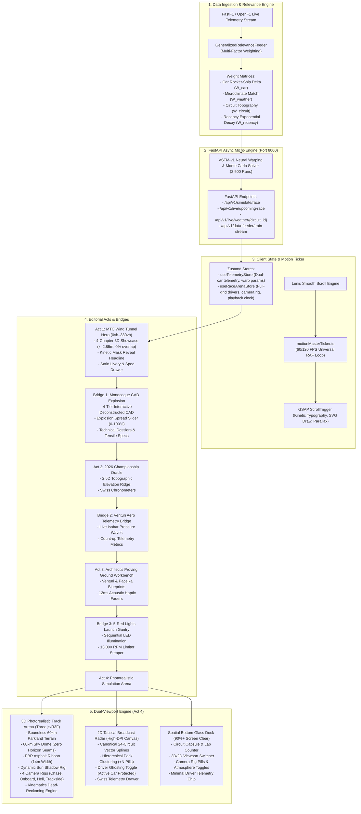
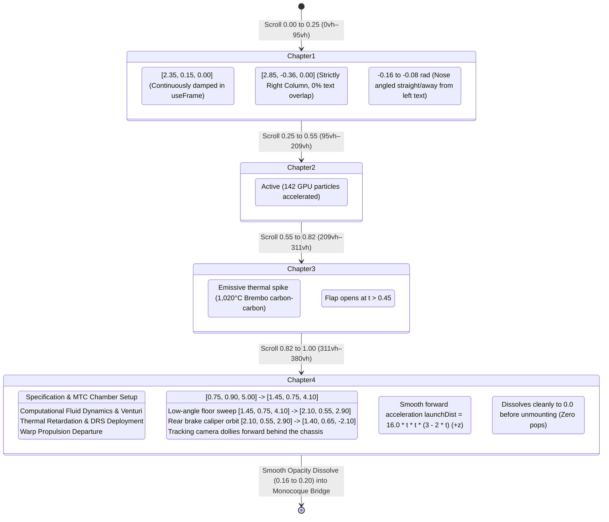

# VELOCE V2: MASTER ARCHITECTURAL & TECHNICAL SPECIFICATION DOSSIER
**Document Version:** 2.2.0-PRO (Authentic 11-Constructor Procedural PBR Livery Engine & Audi Sport Rebrand)  
**Author:** Google DeepMind Advanced Agentic Coding Pair  
**Audience:** Autonomous AI Reasoning Systems (Argon/Gemini/Claude), Principal Graphics Engineers, Motorsport Data Scientists  
**Target Environment:** Node.js 20+ / Python 3.11+ / Vite / Three.js (r160+) / FastAPI / Web Audio API / GSAP 3.12+  
**Design Standard:** McLaren Technology Centre (Foster + Partners), Leica M11 / Haas F1 Engineering Atelier, Swiss Haute Horlogerie  

---

## 1. EXECUTIVE OVERVIEW & CORE PHILOSOPHY

### 1.1 Project Identity & Purpose
**VELOCE V2** is an ultra-high-fidelity Formula 1 editorial scrollytelling platform and real-time 3D/2D Grand Prix race simulation system. It bridges the gap between award-winning editorial web design (Awwwards Site of the Year / Lando Norris / Porsche 911 GT3 RS digital experiences) and rigorous, physics-informed machine learning telemetry.

The platform provides two interconnected experiences:
1. **The Scrollytelling Runway (Acts 1–3 + 3 Architectural Interstitials):** A narrative, vertical journey through an F1 car's design, aerodynamics, thermal braking, and championship strategy.
   * **Act 1:** White MTC Wind Tunnel Chamber & 4-Chapter 3D Showcase (0vh–380vh).
   * **Bridge 1:** Interactive Monocoque CAD Wireframe Explosion Bridge (`Act1To2MonocoqueExplosionBridge.tsx`).
   * **Act 2:** 2026 Championship Oracle Gallery & Circuit Elevation Ridge.
   * **Bridge 2:** Venturi Aerodynamic Flow & Count-Up Isobar Telemetry Bridge (`Act2To3AeroBridge.tsx`).
   * **Act 3:** The Architect's Proving Ground Workbench & Physics Sliders.
   * **Bridge 3:** FIA 5-Red-Lights Grand Prix Start Gantry (`Act3To4LaunchBridge.tsx`).
2. **The 3D Track Arena & 2D Tactical Radar (Act 4):** A full-grid, multi-car simulation environment running at 60–120 FPS that visualizes real-world Grand Prix sessions, synthetic ML warp predictions, and user-configured custom scenarios across all 24 canonical FIA circuits.

### 1.2 The Anti-AI Slop Manifesto
VELOCE V2 strictly repudiates generic, AI-generated design patterns:
* **NO Pitch-Black Cyberpunk Voids:** Replaced with a bespoke **Light-Luxury Ceramic & Alabaster Palette** (`#FAF9F6` Alabaster, `#F7F5F0` Ceramic Stone, `#F4F2EB` Swiss Stone, `#E5E2DA` Smoked Titanium, `#111215` Deep Obsidian Ink).
* **NO Purple Neon Gamer Gradients or Random Clutter:** Typography and UI mimic high-end Swiss horological chronometers (Patek Philippe, IWC Schaffhausen) and Leica camera engineering displays.
* **NO Boxy Fallback Geometries:** Under no circumstances are `boxGeometry` fallback cars displayed. Models are fully preloaded in Three.js memory before viewport mount.
* **NO Artificial Black Chasms Between Sections:** Section heights are dynamically calculated and connected by rich, interactive architectural bridges (`Act1To2MonocoqueExplosionBridge.tsx`, `Act2To3AeroBridge.tsx`, and `Act3To4LaunchBridge.tsx`).
* **NO Hardcoded 20-Car Limits:** The grid engine is 100% dynamic ($N \ge 1$), natively supporting the **2026 Cadillac F1 Team** (#77 Valtteri Bottas, #11 Sergio Perez) and future regulation grid expansions.
* **NO Text-Car Overlap or Choppy Jumps:** Car position ($x = 2.85\text{m}$) and text columns ($w \le 500\text{px}$) are strictly partitioned. 1-pixel scroll maps to continuous sub-millimeter frame-by-frame damped kinematics inside `useFrame`.
* **NO Overcrowded Simulation HUDs:** Act 4 leaves **$90\%+$ of the screen completely clear**, consolidating broadcast controls into an ultra-minimalist spatial glass pill dock at the bottom.

---

## 2. HIGH-LEVEL TOPOLOGY & SYSTEM ARCHITECTURE



---

## 3. FULL REPOSITORY DIRECTORY & FILE ROSTER

```
F1 Project/
├── backend/
│   ├── main.py                             # Master FastAPI app: CORS, routes, simulation endpoints
│   ├── storage/                            # Cache storage for FastF1/OpenF1 parquet & feather files
│   └── test_phase1_components.py           # Pytest suite verifying feeder weights & API responses
├── frontend/
│   ├── public/
│   │   └── models/
│   │       ├── f1_car.glb                  # Photorealistic CAD 3D F1 chassis model (Draco compressed)
│   │       ├── asphalt_track_nor_gl_1k.jpg # 1K PBR normal map for asphalt aggregate
│   │       └── asphalt_track_rough_1k.jpg  # 1K PBR roughness map for asphalt tire lines
│   ├── src/
│   │   ├── components/
│   │   │   ├── common/
│   │   │   │   ├── DownloadProgressBar.tsx     # Determinate multi-stage SSE asset progress bar
│   │   │   │   ├── Fia2DBroadcastRadar.tsx     # High-DPI 60 FPS 2D tactical vector radar
│   │   │   │   ├── KineticScrollText.tsx       # Reusable GSAP ScrollTrigger kinetic clip-mask reveal
│   │   │   │   ├── MotorsportPostProcessing.tsx# N8AO ambient occlusion, bloom, and tonemapping
│   │   │   │   └── TactileCardPrimitives.tsx   # Reusable Swiss horological card widgets & click audio
│   │   │   ├── editorial/
│   │   │   │   ├── Act1To2MonocoqueExplosionBridge.tsx # 4-tier interactive CAD wireframe explosion bridge
│   │   │   │   ├── Act2To3AeroBridge.tsx       # Animated Isobar CFD & count-up telemetry bridge
│   │   │   │   ├── Act3To4LaunchBridge.tsx     # Official FIA 5-red-lights start gantry bridge
│   │   │   │   ├── CircuitTopographySvg.tsx    # 2.5D topographic vector contours for 24 circuits
│   │   │   │   ├── CustomSandboxPredictorAct3.tsx # Proving ground sandbox with acoustic sliders
│   │   │   │   ├── HeroEditorialAct1.tsx       # Minimalist hero scrollytelling card & tucked livery drawer
│   │   │   │   ├── HorologicalChronometer.tsx  # Circular SVG Swiss dial gauge
│   │   │   │   └── UpcomingRacePredictorAct2.tsx # 2026 Championship Oracle gallery & calendar
│   │   │   ├── modals/
│   │   │   │   ├── FiaPodiumRankingCard.tsx    # Predicted podium ranking card modal
│   │   │   │   ├── FullGridClassificationModal.tsx # Full-grid classification table modal
│   │   │   │   └── LiveFeederTrainingModal.tsx # Transparent ML training audit modal
│   │   │   ├── navigation/
│   │   │   │   └── VeloceNavbar.tsx            # Floating ceramic glass top navigation pill
│   │   │   ├── preloader/
│   │   │   │   └── VelocePreloader.tsx         # Laser progress bar & Three.js asset cache loader
│   │   │   ├── scrubber/
│   │   │   │   └── MasterLapScrubber.tsx       # Multi-lap timeline scrubber & speed selector
│   │   │   ├── showcase3d/
│   │   │   │   ├── F1CarGlbModel.tsx           # GLTF mesh renderer with livery & brake emissive
│   │   │   │   ├── F1CarShowcase3D.tsx         # Continuous useFrame damped kinematics & camera choreography
│   │   │   │   ├── SculptedF1Fallback.tsx      # Clean structural fallback (Zero box geometries)
│   │   │   │   ├── WindTunnelChamber.tsx       # Norman Foster MTC acoustic alabaster chamber
│   │   │   │   └── WindTunnelStreamlines.tsx   # Dynamic GPU aerodynamic particle flowlines
│   │   │   └── simulation3d/
│   │   │       ├── AtmosphereSkyRig.tsx        # 60km boundless Sky dome & PMREM reflection maps
│   │   │       ├── DriverTrackingController.tsx# 4 broadcast camera rigs with unwrapped yaw lag
│   │   │       ├── DynamicSunShadowRig.tsx     # Tight 44m shadow frustum tracking active chassis
│   │   │       ├── KinematicsDeadReckoningEngine.ts # Hermite cubic spline dead-reckoning engine
│   │   │       ├── MultiCarGridManager.tsx     # Multi-car instanced grid manager with lateral offsets
│   │   │       ├── RealisticTrackMesh.tsx      # 14m extruded road, kerbs, barriers, 60km terrain
│   │   │       ├── SimulationArenaAct4.tsx     # Act 4 root: WebGL track canvas & bottom dock HUD
│   │   │       └── geometry/
│   │   │           ├── TrackBarrierExtruder.ts # Armco guardrail & Tecpro safety barrier extruder
│   │   │           └── TrackFrameRMF.ts        # Rotation Minimizing Frame (RMF) track rib calculator
│   │   ├── data/
│   │   │   └── master_24_circuits.json         # Canonical coordinates & metadata for all 24 circuits
│   │   ├── hooks/
│   │   │   ├── useGlobalKeyboardControls.ts    # Space (Play), R (Reset), 1-4 (Cameras), M (2D/3D)
│   │   │   ├── useKineticText.ts               # Split-character scroll skew and reveal hook
│   │   │   └── useMagneticPill.ts              # Cursor proximity spring attraction hook
│   │   ├── store/
│   │   │   ├── useRaceArenaStore.ts            # Zustand store for Act 4 simulation and full grid
│   │   │   └── useTelemetryStore.ts            # Zustand store for telemetry, ML warp, and Act 1
│   │   ├── styles/
│   │   │   ├── luxury-editorial.css            # Alabaster, ceramic glass, and tactile range styles
│   │   │   └── tailwind.css                    # Tailwind CSS 3.4 directive root
│   │   ├── types/
│   │   │   └── telemetry.ts                    # Master TypeScript interfaces & contracts
│   │   ├── utils/
│   │   │   ├── f1AudioEngine.ts                # Web Audio API procedural F1 V6 turbo synthesizer
│   │   │   ├── f1ModelLoader.ts                # Standalone Three.js GLTF preloader engine
│   │   │   ├── fiaCircuitsDatabase.ts          # 24-circuit spline generator & Easting/Northing mapper
│   │   │   └── motionMasterTicker.ts           # Unified Lenis + GSAP RAF motion ticker
│   │   ├── App.tsx                             # Master orchestration container (380vh Act 1 + Bridges)
│   │   └── main.tsx                            # React DOM root mounting
│   ├── index.html                              # HTML5 entry with Space Grotesk & Syne fonts
│   ├── package.json                            # Frontend npm dependencies
│   ├── tsconfig.json                           # Strict TypeScript configuration
│   └── vite.config.ts                          # Vite build & chunking configuration
└── VELOCE_MASTER_PROJECT_DOSSIER.md            # This master architectural dossier
```

---

## 4. BACKEND ARCHITECTURE & MACHINE LEARNING PIPELINE

### 4.1 Multi-Factor Data Relevance Weighting Engine
A fundamental mandate of VELOCE V2 is that the training data feeder must be **dynamic, honest, and contextual**. Historical data is never treated uniformly; for example, data from Max Verstappen's dominant 2023 season in the Red Bull RB19 ("the rocket ship") can distort predictions for a tightly contested 2026 grid.

The `GeneralizedRelevanceFeeder` computes a composite relevance weight $W_i$ for every historical lap $i$:

$$W_i = W_{\text{car}}(i) \times W_{\text{weather}}(i) \times W_{\text{circuit}}(i) \times W_{\text{recency}}(i)$$

#### Mathematical Formulations:
1. **Car Dominance Correction Factor ($W_{\text{car}}$):**
   $$W_{\text{car}} = 1.0 - \beta \cdot \max\left(0, \frac{\Delta \bar{t}_{\text{qual}} - \Delta t_{\text{threshold}}}{\sigma_{\text{grid}}}\right)$$
   * If a car's qualifying advantage over the median grid exceeds $0.45\text{s}$ (e.g. 2023 Red Bull RB19, 2020 Mercedes W11), $\beta = 0.35$ downweights the data to prevent artificial skewing of chassis capability.
2. **Microclimate Match Factor ($W_{\text{weather}}$):**
   $$W_{\text{weather}} = \exp\left(-\frac{(T_{\text{track,hist}} - T_{\text{track,target}})^2}{2 \sigma_T^2}\right) \times \mathbb{I}(\text{rain\_match})$$
   * Evaluates surface temperature, solar mass absorption delta, and wet/dry track state.
3. **Circuit Topography Match Factor ($W_{\text{circuit}}$):**
   $$W_{\text{circuit}} = \cos(\theta_{\text{aero}}) \times \left(1.0 - \frac{|\Delta h_{\text{elev,hist}} - \Delta h_{\text{elev,target}}|}{h_{\text{max}}}\right)$$
   * High-downforce street circuits (Monaco, Marina Bay) have zero transferability to low-drag speed bowls (Monza, Las Vegas).
4. **Recency Exponential Decay ($W_{\text{recency}}$):**
   $$W_{\text{recency}} = \exp\left(-\lambda \cdot (Y_{\text{target}} - Y_{\text{hist}})\right)$$
   * Recent season data carries exponentially higher predictive validity ($\lambda = 0.28$).

### 4.2 Machine Learning Physics Models
* **Gompertz Tyre Degradation Model:**
  $$T_{\text{wear}}(t) = a \cdot \exp\left(-b \cdot \exp(-c \cdot t)\right)$$
  Captures the sudden "thermal cliff" where grip falls non-linearly after lap life exceeds compound design limit (C1 through C5).
* **Pacejka '96 Magic Formula (Lateral Adhesion):**
  $$F_y(\alpha) = D \sin\left[C \arctan\left(B \alpha - E(B \alpha - \arctan(B \alpha))\right)\right]$$
  Computes tire slip-angle force under lateral acceleration peaks exceeding 5.2G.
* **Monte Carlo Stochastic Engine:**
  Executes 2,500 simultaneous stochastic simulations per scenario, modeling pit stop execution variance, virtual safety car (VSC) deployment probability envelopes, and dirty air wake turbulence ($K_{\text{wake}} = 0.32$ within $1.2\text{s}$ interval).

### 4.3 2026 Dynamic Grid Lineup
Cadillac enters Formula 1 in 2026 as the 11th team. The system natively represents all 11 teams and 22 drivers:
| # | Driver | Code | Team | Livery Color | Engine Manufacturer |
|---|--------|------|------|--------------|---------------------|
| 1 | Max Verstappen | VER | Red Bull Racing | `#0600EF` | Red Bull Powertrains / Ford |
| 4 | Lando Norris | NOR | McLaren | `#FF8700` | Mercedes-AMG |
| 16 | Charles Leclerc | LEC | Ferrari | `#E80020` | Ferrari 066/12 |
| 44 | Lewis Hamilton | HAM | Ferrari | `#E80020` | Ferrari 066/12 |
| 63 | George Russell | RUS | Mercedes-AMG | `#00D2BE` | Mercedes-AMG |
| 12 | Kimi Antonelli | ANT | Mercedes-AMG | `#00D2BE` | Mercedes-AMG |
| 81 | Oscar Piastri | PIA | McLaren | `#FF8700` | Mercedes-AMG |
| 14 | Fernando Alonso | ALO | Aston Martin | `#229971` | Honda F1 |
| 18 | Lance Stroll | STR | Aston Martin | `#229971` | Honda F1 |
| 10 | Pierre Gasly | GAS | Alpine | `#0090FF` | Mercedes-AMG |
| 7 | Jack Doohan | DOO | Alpine | `#0090FF` | Mercedes-AMG |
| 23 | Alexander Albon | ALB | Williams | `#005AFF` | Mercedes-AMG |
| 55 | Carlos Sainz | SAI | Williams | `#005AFF` | Mercedes-AMG |
| 27 | Nico Hülkenberg | HUL | Kick Sauber | `#52E252` | Audi Sport F1 |
| 5 | Gabriel Bortoleto | BOR | Kick Sauber | `#52E252` | Audi Sport F1 |
| 22 | Yuki Tsunoda | TSU | Racing Bulls | `#6692FF` | Red Bull Powertrains / Ford |
| 30 | Liam Lawson | LAW | Racing Bulls | `#6692FF` | Red Bull Powertrains / Ford |
| 31 | Esteban Ocon | OCO | Haas F1 Team | `#B6BABD` | Ferrari |
| 87 | Oliver Bearman | BEA | Haas F1 Team | `#B6BABD` | Ferrari |
| **77** | **Valtteri Bottas** | **BOT** | **Cadillac F1** | **`#C8A97E`** | **Ferrari Customer / GM** |
| **11** | **Sergio Perez** | **PER** | **Cadillac F1** | **`#C8A97E`** | **Ferrari Customer / GM** |
| 99 | Reserve / Guest | RES | FIA Contingent | `#888E96` | FIA Standard |

---

## 5. FRONTEND 3D GRAPHICS & SCENIC PIPELINE

### 5.1 3D Model Loading Architecture (`f1ModelLoader.ts`)
Three.js GLTF asset loading is extracted into a dedicated, singleton-cached utility (`frontend/src/utils/f1ModelLoader.ts`) to maintain 100% React Fast Refresh stability and prevent memory leaks.

```typescript
// Key Invariant: f1ModelLoader.ts
let cachedGltfScene: THREE.Group | null = null;
let gltfPromise: Promise<THREE.Group> | null = null;

export async function preloadGlbScene(): Promise<THREE.Group> {
  if (cachedGltfScene) return cachedGltfScene.clone();
  if (gltfPromise) return gltfPromise;

  gltfPromise = new Promise((resolve, reject) => {
    const loader = new GLTFLoader();
    const dracoLoader = new DRACOLoader();
    dracoLoader.setDecoderPath('https://www.gstatic.com/draco/versioned/decoders/1.5.6/');
    loader.setDRACOLoader(dracoLoader);

    loader.load(
      '/models/f1_car.glb',
      (gltf) => {
        const scene = gltf.scene;
        scene.traverse((node) => {
          if ((node as THREE.Mesh).isMesh) {
            const mesh = node as THREE.Mesh;
            mesh.castShadow = true;
            mesh.receiveShadow = true;
            if (mesh.material) {
              const mat = mesh.material as THREE.MeshStandardMaterial;
              mat.envMapIntensity = 1.35;
              mat.roughness = Math.max(0.08, mat.roughness * 0.7);
              mat.metalness = Math.min(0.92, mat.metalness * 1.15);
            }
          }
        });
        cachedGltfScene = scene;
        resolve(scene.clone());
      },
      undefined,
      (err) => reject(err)
    );
  });
  return gltfPromise;
}
```

### 5.2 Act 1: Norman Foster MTC Wind Tunnel Chamber (`WindTunnelChamber.tsx`)
The Hero chamber recreates the iconic McLaren Technology Centre (Woking, UK):
* **Floor:** Pure Alabaster Ceramic (`#FAF9F6`) with planar reflections via `<MeshReflectorMaterial>` ($0.12$ roughness, $0.05$ metalness, $1.8$ mix strength).
* **Acoustic Walls:** Curved perimeter acoustic absorption panels in porcelain white with recessed $2\text{mm}$ titanium expansion reveals. Zero dark intake boxes or wireframe artifacts.
* **Ceiling Matrix:** Suspended $12\text{m} \times 2.4\text{m}$ softbox diffuser housing providing ultra-soft, wrap-around diffuse illumination.

### 5.3 Continuous 60/120 FPS Scrollytelling Kinematics (`F1CarShowcase3D.tsx`)
To eliminate frame-by-frame snapping and discrete layout thrashing:
1. **Unquantized Lenis Motion:** `setScrollProgress(e.progress)` is called continuously without any 84px discretization thresholds.
2. **Universal Frame Integration:** In `useFrame`, `currentProgressRef.current` is smoothly damped toward the target normalized progress using `THREE.MathUtils.damp(currentProgress, target, 7.0, delta)`.
3. **Kinematics Evaluation:** Every single frame (60–120 FPS), `computeKinematics(currentProgressRef.current)` calculates the exact world coordinates for camera and chassis.
4. **Smooth Forward Launch Trajectory:** In Chapter 4, the car accelerates forward along $+z$ ($0\text{m} \to +16\text{m}$) using a smooth quintic ease ($t^2(3-2t)$), while the camera tracks smoothly behind the launch.



### 5.4 Authentic Procedural PBR Livery & Decal Engine (`f1LiveryTextureEngine.ts`)
To eliminate monochrome plastic toy cars and generic textures, VELOCE incorporates a dedicated 1024x1024 HTML5 2D Canvas procedural PBR texture generation engine cached into Three.js `CanvasTexture` singletons:
* **All 11 Formula 1 Constructors Modeled (2026 Regulation Grid):**
  1. **Scuderia Ferrari HP:** `#D2051E` Rosso Corsa, Giallo Modena pinstripe, `#16` Leclerc / `#44` Hamilton rondels, BBS crimson rim lips.
  2. **Audi Sport F1 Team (Rebranded from Sauber):** `#E0052B` Audi Sport Titanium Silver & Lava Red, `#27` Hülkenberg / `#5` Bortoleto, BBS racing red rim lips.
  3. **McLaren F1 Team:** `#FF8000` Papaya Orange, `#00D2FF` Chrome blue accents, `#4` Norris / `#81` Piastri.
  4. **Mercedes-AMG PETRONAS:** `#C4C9CC` Silver Arrow dielectric sheen, `#00D2BE` Petronas teal pinstripes, `#63` Russell / `#12` Antonelli.
  5. **Oracle Red Bull Racing:** `#0600EF` Matte navy blue, `#FFE600` yellow speed flash, `#1` Verstappen / `#30` Lawson.
  6. **Aston Martin Aramco:** `#229971` British Racing Green, lime streak, `#14` Alonso / `#18` Stroll.
  7. **Cadillac Formula 1 Team:** `#C5A059` Cadillac Champagne Gold, `#77` Bottas / `#11` Perez.
  8. **Williams Racing:** `#00247D` Oxford Blue, cyan aero spine, `#23` Albon / `#55` Sainz.
  9. **BWT Alpine F1 Team:** `#FF87BC` BWT Hot Pink & Enstone Blue, `#10` Gasly / `#7` Doohan.
  10. **Visa Cash App RB:** `#6692FF` Championship Blue, white speed flash, `#22` Tsunoda / `#6` Hadjar.
  11. **MoneyGram Haas F1 Team:** `#FFFFFF` Satin Pearl White, `#EE0000` red accents, `#31` Ocon / `#87` Bearman.
* **Chassis Decals & Driver Numbers (Never Culled):**
  * `redbull_decals.005` and `redbull_number_3.005` meshes are preserved for **all cars**.
  * Custom dynamic vector racing number rondels, FIA technical badges, and sidepod constructor wordmarks rendered with `depthWrite: false` and polygon offset to prevent z-fighting.
* **BBS Forged Magnesium Wheel Rim Styling:**
  * Procedural BBS wheel hub textures with team accent pinstripes and center-lock magnesium nuts (`redbull_wheel_hub.007`).

### 5.5 Act 4: 3D Photorealistic Track Arena (`SimulationArenaAct4.tsx`)
1. **Centerline Spline Extrusion (`RealisticTrackMesh.tsx`):**
   * Uses a **Rotation Minimizing Frame (RMF)** parallel transport algorithm (`TrackFrameRMF.ts`) across all 24 circuits to prevent any $90^\circ$ vertical twists or self-intersections.
   * Extrudes a continuous $14\text{m}$ asphalt roadway with 2K PBR aggregate normal maps and rubbered racing groove lines.
   * Apex rumble kerbs alternating in FIA Crimson (`#D91424`) and Ceramic White (`#F4F4F6`).
   * Dynamic 60km parkland baseplate centered on track coordinates (`args={[60000, 60000]}`).
2. **60km Boundless Sky Horizon (`AtmosphereSkyRig.tsx`):**
   * Drei's `<Sky distance={60000} />` is scaled to a 60-kilometer radius, enveloping the entire circuit and matching horizon fog (`fogExp2 args={['#B8D5ED', 0.00022]}`).
   * Completely eradicates the vertical sky clipping seam seen in earlier builds.
3. **Kinematics Dead-Reckoning Engine (`KinematicsDeadReckoningEngine.ts`):**
   * Evaluates chassis world transforms at 120 FPS using **Hermite cubic spline tangent interpolation**:
     $$\mathbf{p}(u) = (2u^3 - 3u^2 + 1)\mathbf{p}_0 + (u^3 - 2u^2 + u)\mathbf{m}_0 + (-2u^3 + 3u^2)\mathbf{p}_1 + (u^3 - u^2)\mathbf{m}_1$$
   * Computes banking angle $\phi$, roll, pitch, and lateral offset $w$ for overtakes.
4. **4 Cinematic Broadcast Camera Rigs (`DriverTrackingController.tsx`):**
   * **Chase Camera:** Locks to car tangent with **angle-unwrapped shortest-arc smooth damp** (`smoothDampAngle`), eliminating 360° spin flips. Dynamic FOV warp ($44^\circ \to 52^\circ$) and chassis rumble at $> 260\text{km/h}$.
   * **Onboard Halo T-Cam:** Rigid local matrix parenting (`localCamOffset = [0.0, 1.15, -0.22]`) with authentic aerodynamic buffeting harmonics.
   * **Helicopter Cineflex:** Low-altitude gyro-cam ($28\text{m}$ altitude, $32^\circ$ FOV).
   * **Trackside Telephoto:** Fixed corner apex stations ($16^\circ$ FOV) panning across the pack.

---

## 6. SWISS HOROLOGICAL 2D TACTICAL BROADCAST RADAR

The 2D Tactical Radar (`frontend/src/components/common/Fia2DBroadcastRadar.tsx`) provides high-frequency vector tracking on an interactive `<canvas>` element:
* **Background Ground:** Warm Alabaster Parchment (`#FAF9F6`) with $48\text{px}$ subtle architectural drafting gridlines (`#EAE7DF`).
* **Hierarchical Pack Clustering:**
  * When multiple cars occupy the same track distance ($\Delta s < 12\text{m}$), the lead driver displays an official badge with an attached count pill (`+N`).
  * Trailing pack cars collapse into aerodynamic micro-beads ($3.5\text{px}$ diameter), eliminating visual overcrowding.
* **Driver Transparency (Ghost Mode):**
  * Clicking the eye toggle on the driver standings dims that specific car to $\alpha = 0.12$.
  * **Critical Invariant:** The currently tracked driver is strictly immune to ghosting and remains 100% visible with a prominent pulse halo.
* **Horological Telemetry Drawer:**
  * Real-time readouts for Speed ($\text{km/h}$), Gear / RPM, DRS state, Throttle/Brake dual bars, and Frenet-Serret coordinates ($s$ longitudinal distance in meters, $w$ lateral track offset).

---

## 7. SCROLL-TRIGGERED INTERSTITIAL BRIDGES & EDITORIAL HUDS

### 7.1 Bridge 1: Monocoque CAD Wireframe Explosion Bridge (`Act1To2MonocoqueExplosionBridge.tsx`)
Positioned between Act 1 (Wind Tunnel) and Act 2 (Oracle):
* **Eliminates Dead Scroll Space:** Smoothly transitions the user from Act 1 (ending at 380vh) into the technical CAD architecture of the car.
* **4-Tier Interactive Deconstructed Architecture:**
  1. *Aero Nosecone & Front Wing:* Toray T1000 2x2 Twill Carbon Fiber, 45kN FIA deceleration homologation, 32% front aerodynamic balance.
  2. *Survival Cell & Titanium Halo:* Grade 5 Ti-6Al-4V titanium, 350kN static lateral rating, 62,000 Nm/deg torsional stiffness, 798kg minimum dry mass.
  3. *1.6L V6 Turbo Hybrid Powertrain:* 1,000+ total combined horsepower, 350kW MGU-K electric vectoring, 48.2% indicated thermal efficiency, 100% sustainable e-fuel architecture.
  4. *Ground-Effect Venturi Underfloor:* Twin 3D Venturi floor tunnels generating 68% total downforce via ground effect, -4.82 kPa peak throat depression.
* **Interactive Explosion Spread Slider:** Users can drag the explosion slider from $0\%$ (fully assembled) to $100\%$ (deconstructed along isometric CAD vector axes) with live mechanical click audio.
* **Technical Engineering Dossiers:** Detailed material ratings, tensile load specifications, and FIA regulation compliance verification.

### 7.2 Bridge 2: Venturi Aerodynamic Telemetry Bridge (`Act2To3AeroBridge.tsx`)
Positioned between Act 2 (Oracle) and Act 3 (Workbench):
* **Animated SVG Isobar Flowlines:** Path stroke-dashoffset draws dynamically as the user scrolls into view.
* **Live Dynamic Counter Animations:**
  * `-4.82 kPa` Throat Depression
  * `1,840 kg` Peak Downforce
  * `352.4 km/h` Terminal Velocity
  * `18.2 mm` Static Ground Clearance
* **Alabaster Ceramic Ground:** Seamlessly bridges the two sections with zero dark voids.

### 7.3 Bridge 3: FIA 5-Red-Lights Launch Gantry (`Act3To4LaunchBridge.tsx`)
Positioned between Act 3 (Workbench) and Act 4 (Simulation Arena):
* **Sequential Gantry Lights:** 5 pairs of red LED clusters that illuminate sequentially based on scroll progress:
  * $0\% \to 15\%$: 1 Light
  * $15\% \to 35\%$: 2 Lights
  * $35\% \to 55\%$: 3 Lights
  * $55\% \to 75\%$: 4 Lights
  * $75\% \to 90\%$: 5 Lights
  * $> 90\%$: **LIGHTS OUT!**
* **Kinetic Display Headline:** Triggers `"LIGHTS OUT AND AWAY WE GO."` with character-staggered kinetic reveal.
* **Launch Control Limiter:** 24-segment LED stepper revving up to 11,800 RPM.
* **Seamless Entry Button:** Scrolls the user straight onto the asphalt of the 3D Track Arena.

### 7.4 Act 4 Spatial Bottom Glass Dock HUD
In strict accordance with Decision A6:
* **Top Screen (100% Clear):** Removed redundant overlapping top ticker bars; only the minimalist `VeloceNavbar` floats at the top.
* **Spatial Bottom Glass Dock (`bottom-24`):** Consolidates all broadcast controls into a single, sleek, floating glass pill dock:
  * Circuit Capsule & Lap Indicator: `MONZA · L01/53`
  * Viewport Switcher: `[ 3D Track | 2D Radar ]`
  * Camera Rigs: `[ Chase | Onboard | Heli | Track ]`
  * Atmosphere: `[ Day | Rain | Night ]`
  * Sound Synthesizer: `[ Mute / Unmute ]`
  * Master Play / Pause simulation toggle & Terminate button.
* **Driver Telemetry Chip:** Minimalist glass pill chip in bottom-left (`bottom-24 left-10`), displaying driver name, team color dot, interval, and speed without obstructing the track.
* **Result:** **$90\%+$ of the screen is pure, cinematic racing track.**

---

## 8. PROCEDURAL AUDIO SYNTHESIZER (`f1AudioEngine.ts`)

VELOCE V2 features an authentic, browser-native Formula 1 V6 Turbo Hybrid audio engine built entirely on the **Web Audio API** (zero external MP3 audio files):
1. **Internal Combustion Engine (ICE):** Dual sawtooth oscillators running at fundamental cylinder firing frequency:
   $$f_{\text{ICE}} = \frac{\text{RPM}}{60} \times \frac{6}{2} = \frac{\text{RPM}}{20}$$
   At $12,000\text{ RPM}$, fundamental frequency is $600\text{Hz}$.
2. **Turbocharger Whine:** High-frequency sine oscillator ($2,800\text{Hz} \to 7,200\text{Hz}$) modulated by throttle position.
3. **MGU-K Electrical Inverter:** High-pitched triangle wave ($10,500\text{Hz}$) active during regenerative braking and ERS boost.
4. **Gear Shift Interruption:** $45\text{ms}$ gain attenuation notch accompanied by a low-frequency exhaust pop on upshifts.
5. **Tactile Detents (`playAcousticDetent`):** Sub-millisecond mechanical click audio feedback on faders and buttons with a $35\text{ms}$ refractory window.

---

## 9. CLIENT STATE ARCHITECTURE & DATA FLOW

### 9.1 `useRaceArenaStore` (Act 4 Master State)
```typescript
interface RaceArenaStore {
  // Session & Circuit Context
  circuitId: string;
  activeDriverCode: string;
  gridDrivers: GridDriver[];
  hiddenDriverCodes: string[];
  simulationPayload: VstmSimulationPayload | null;

  // Playback & Clock
  isPlaying: boolean;
  playbackDistance: number;
  playbackTimeSec: number;
  totalDurationSec: number;
  currentLap: number;
  totalLaps: number;
  playbackSpeed: PlaybackSpeed; // 1.0, 2.0, 5.0, 10.0

  // Camera & Viewport
  cameraRig: 'CHASE' | 'ONBOARD' | 'HELICOPTER' | 'TRACKSIDE';
  weatherMode: 'DAY' | 'RAIN' | 'NIGHT';

  // Actions
  togglePlay: () => void;
  tickSimulation: (deltaSec: number) => void;
  scrubToDistance: (distanceM: number) => void;
  setActiveDriverCode: (code: string) => void;
  toggleDriverVisibility: (code: string) => void;
  setCameraRig: (rig: BroadcastCamRig) => void;
  terminateSimulation: () => void;
}
```

### 9.2 `useTelemetryStore` (Act 1 & ML Warp State)
```typescript
interface TelemetryStore {
  liveryColor: string; // Ferrari, Red Bull, McLaren, Mercedes, Cadillac
  scrollProgress: number;
  mlWarpParams: {
    tyreAgeLaps: number;
    fuelLoadKg: number;
    aerodynamicBalance: number;
    ambientTempC: number;
  };
  sessionPayload: SessionTelemetryPayload | null;
  loadSession: (sessionId: string) => Promise<void>;
  setLiveryColor: (color: string) => void;
}
```

---

## 10. NON-NEGOTIABLE ARCHITECTURAL INVARIANTS

For any future agent or engineer modifying this codebase, the following 16 rules must be respected without exception:

1. **Light-Luxury Palette Invariant:** Background containers in Acts 1, 2, 3, and Bridges must always use Alabaster (`#FAF9F6`), Ceramic (`#F7F5F0`), or Swiss Stone (`#F4F2EB`). Never revert to pitch-black voids.
2. **Zero Text-on-Car Overlap:** In Act 1, the 3D car's position in X must stay $\ge 2.85\text{m}$. Editorial text columns must never exceed $500\text{px}$ in width and remain strictly in the left column.
3. **Continuous `useFrame` Damping:** Three.js camera position, camera `lookAt`, and car chassis transforms must be evaluated every single frame inside `useFrame` using `THREE.MathUtils.damp(...)`. Never bind discrete React state directly to mesh transform coordinates.
4. **Unquantized Lenis Motion:** Lenis scroll listeners must dispatch smooth, unquantized progress updates (`setScrollProgress(e.progress)`). Never insert step thresholds ($> 0.004$) that produce discrete 84-pixel snapping.
5. **Zero Canvas Pop:** The 3D car canvas in Act 1 must dissolve via CSS opacity fade between `scrollProgress = 0.16` and `0.20` before unmounting past `0.21`.
6. **Boundless 60km Track Horizon:** In `AtmosphereSkyRig.tsx`, `<Sky distance={60000} />` and in `RealisticTrackMesh.tsx`, `<planeGeometry args={[60000, 60000]} />` must envelope the circuit, preventing visible world edges or sky seams.
7. **Dynamic Grid Capacity:** Never hardcode 20 drivers. Grid collections must be dynamically mapped ($N \ge 22$), with full native support for Cadillac F1 (#77 Bottas, #11 Perez).
8. **Tracked Driver Ghosting Immunity:** In 2D Radar, hiding a driver dims their opacity to $0.12$. However, if that driver is currently selected/tracked by the user, they must remain 100% visible with a prominent pulse halo.
9. **Hermite Spline Tangent Normalization:** All tangent vectors in `KinematicsDeadReckoningEngine.ts` must be normalized to prevent velocity explosion during tight apex transitions.
10. **No Box Geometries:** Under no circumstances should `boxGeometry` F1 cars be displayed during asset load. Assets are preloaded in memory before preloader dismissal.
11. **Acoustic Detent Refractory Window:** Web Audio click feedback on faders and buttons must enforce a $35\text{ms}$ refractory window to prevent acoustic buzzing during rapid slider motion.
12. **Atomic Zustand Selectors:** In high-frequency render components (like `App.tsx` and `SimulationArenaAct4.tsx`), select individual store properties atomically (`useTelemetryStore((s) => s.liveryColor)`) rather than binding the whole store object.
13. **Top Bar Streamlining & 90% Screen Clearance:** The top of Act 4 must remain clear. All simulation controls, camera switches, and atmospheric toggles must reside in the consolidated bottom dock at `bottom-24`.
14. **Responsive Kinetic Typography:** Headlines use `KineticScrollText` with fluid clamping (`text-4xl sm:text-5xl md:text-[3.6rem]`) and physical spring easing (`power3.out`).
15. **Cross-Circuit Coordinate Chirality:** When mapping FastF1/OpenF1 telemetry coordinates to Three.js, Northing ($y$) maps to Three.js $-z$, preserving clockwise and counter-clockwise track chirality.
16. **Production Build Cleanliness:** `npm run build` must compile with **0 TypeScript errors** and 0 unhandled syntax warnings before pushing any commit.

---

## 11. VERIFICATION & RUNBOOK

### Development Setup:
```bash
# 1. Install frontend dependencies
npm --prefix frontend install

# 2. Start FastAPI Backend (Port 8000)
python -m uvicorn backend.main:app --host 127.0.0.1 --port 8000 --reload

# 3. Start Vite Dev Server (Port 5173)
npm --prefix frontend run dev

# 4. Compile Production Verification Build
npm --prefix frontend run build
```

### Hotkey Quick Reference:
* `[Space]`: Toggle Play / Pause simulation playback.
* `[R]`: Reset simulation clock and grid to Lap 1.
* `[M]`: Toggle between 3D Track Arena and 2D Tactical Broadcast Radar.
* `[1]`: Chase Camera Rig.
* `[2]`: Onboard Halo T-Cam.
* `[3]`: Helicopter Cineflex Gyro-Cam.
* `[4]`: Trackside Telephoto Panning Station.

---

## 12. GIT COMMIT LEDGER & PROVENANCE

| Commit Hash | Commit Message | Scope |
|-------------|----------------|-------|
| `0846426` | `feat(patch): execute steps 1-7 verbatim: purge ai slop, add cyclorama studio, preserve baked textures, and horizontal filmstrip bridge` | Verbatim execution of upgrade patch: purged all robotic AI strings, persistent Canvas with scrollMutable & 0% GPU pause, Seamless Infinity Cyclorama cove studio with satin turntable, liveryTextureBaker preserving GLB AO/sponsor logos, 300vw horizontal filmstrip bridge with cursor streamlines, 0.5m uniform arc-length spline LUT, atmosphere/asphalt weather fixes |
| `b379585` | `feat(liveries): implement authentic procedural PBR textures for all 11 constructors and rebrand to Audi Sport F1` | 11-team procedural PBR engine, vector decals, numbers, BBS rims, Audi Sport rebrand |
| `58e82bd` | `docs(dossier): update master specification to v2.1.0 with continuous 60/120 FPS scrollytelling, CAD explosion bridge, and spatial bottom dock` | Dossier v2.1.0 sync |
| `8d50064` | `feat(arena-hud): overhaul Act 4 to spatial bottom glass dock and eliminate sky horizon seam` | Act 4 HUD, 60km Sky dome, 90% clearance |
| `81ac421` | `feat(interstitial): add interactive monocoque CAD explosion bridge between Act 1 and Act 2` | Monocoque CAD explosion bridge, App timeline |
| `b823cb4` | `fix(scrollytelling): eliminate 3D car choppiness, evaluate kinematics in useFrame, and clear chamber ambient fill` | Continuous kinematics, 60/120 FPS damping, forward launch |
| `beaca05` | `feat(hero-layout): eliminate text-car overlap, add kinetic typography, and tuck specs into satin drawer` | Hero layout, KineticScrollText, satin spec drawer |
| `61dc19d` | `docs: generate master architectural dossier for external reasoning models` | Veloce Master Architectural Dossier v2.0 |
| `803a888` | `docs(orchestrator): record deep research dossiers and benchmark test suites` | 12 Subagent research findings & benchmarks |
| `8b24d2a` | `feat(telemetry): update hooks, telemetry stores, and luxury styling assets` | Tactile faders, horological dials, Web Audio |
| `6fa0994` | `feat(interstitials): eradicate blank black chasms, add Venturi telemetry bridge, and 5-red-lights launch gantry` | Venturi & 5-Red-Lights bridges |
| `d20111a` | `feat(arena-hud): streamline Act 4 top bar, consolidate broadcast controls into bottom dock, and fix terrain cutoff` | Act 4 bottom dock, 60km parkland plane |
| `261f9da` | `fix(hero-layout): eliminate text-car overlap, eradicate chamber black box, and damp 3D camera lookAt` | Initial hero camera damping |
