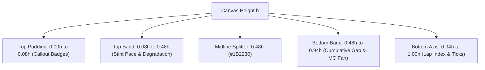
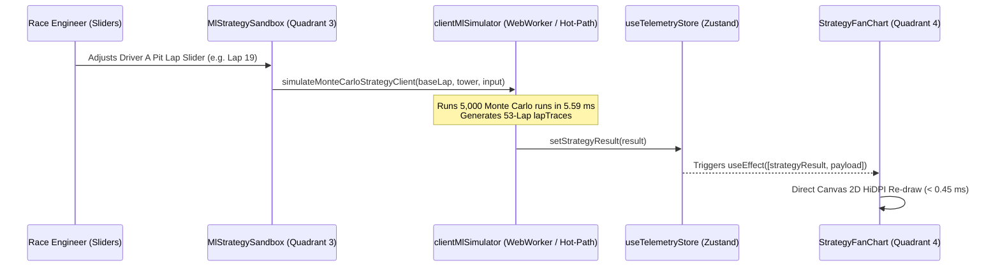

# AeroSpec Technical Research Report: Strategy Stint Pace Curves, Tire Degradation Slopes & Pit Callout Architecture
**Project:** AERO-SPEC F1 Telemetry & ML Strategy Cockpit  
**Subsystem:** Phase 5 Architecture: Quadrant 4 (`Zone 4`), ML Mode Top Band (`StrategyFanChart.tsx`)  
**Specialist Role:** Strategy Stint Pace Specialist  
**Authoritative Contracts:** `AERO-SPEC-ML-AG-CONTRACT-v5.0`, `aero_spec_antigravity_master_blueprint.md` (Sections 1.1, 3.0, 5.5; lines 62–70, 149–154, 1735–1886, 2404–2407), `frontend/src/types/telemetry.ts`, `frontend/src/utils/clientMlSimulator.ts`  
**Target Performance Invariant:** Continuous 60.0 FPS HiDPI Canvas 2D rendering with **$< 0.50\text{ ms}$ render execution budget** per frame, sub-pixel grid alignment, and **0 React Virtual-DOM re-renders** during active strategy exploration.

---

## Executive Summary & Cockpit Context

In Formula 1 race engineering (as utilized on the pit wall by teams such as Red Bull Racing, Scuderia Ferrari, and McLaren F1), tactical race victory is dictated by the precise interplay between **tire thermal degradation**, **fuel burn weight reduction**, and **pit lane transit loss**. A strategy visualization interface must simultaneously communicate two fundamentally different temporal scales:
1. **Macro Stint Evolution (Lap-by-Lap Stint Pace):** The second-by-second micro pace of each car over 50–78 laps, showing when a softer compound surpasses its thermal cliff and crosses over with a harder compound.
2. **Discrete Pit Stop Disruptions (In-Lap / Out-Lap Spikes):** The massive $+20.0\text{s}$ to $+25.0\text{s}$ temporal penalty incurred during the pit lane transit and stationary 4-wheel tire swap.

Within the AERO-SPEC Cockpit architecture, **Zone 4** (the bottom-center master oscillograph container) operates as a polymorphic visualization viewport:
- **Telemetry Lab Mode (`cockpitMode === 'TELEMETRY_LAB'`):** Mounts `TelemetryOscillograph.tsx`, rendering high-frequency 60 FPS 1-meter spatial channels (Speed, $\Delta t$, Throttle, Brake, and ML Ghost Speed trace).
- **ML Strategy Oracle Mode (`cockpitMode === 'ML_STRATEGY_ORACLE'`):** Mounts `StrategyFanChart.tsx`, transforming the spatial canvas into a 53-Lap temporal race trajectory display.

```
+---------------------------------------------------------------------------------------------------+
| ZONE 4: STRATEGY FAN CHART (ML_STRATEGY_ORACLE MODE)                                              |
+---------------------------------------------------------------------------------------------------+
|  TOP BAND (y: 0.08h -> 0.48h): STINT PACE & TIRE DEGRADATION SLOPES                               |
|   - Driver A (#00E5FF, Cyan) vs Driver B (#B000FF, Purple) predicted lap times                    |
|   - Non-linear Compound Cliffs: Soft [S], Medium [M], Hard [H] degradation curves                |
|   - Fuel Burn Compensation: -0.032 s/kg (~ -0.060 s/lap) countering tire wear                     |
|   - Clamped Pit Lap Spikes with Vertical Box Callouts: "BOX L19 [H]"                              |
+---------------------------------------------------------------------------------------------------+
|  MIDLINE DIVIDER (y = 0.48h, #1B2230)                                                            |
+---------------------------------------------------------------------------------------------------+
|  BOTTOM BAND (y: 0.48h -> 0.96h): CUMULATIVE RACE GAP & P10-P90 MONTE CARLO FAN BAND              |
|   - Median Gap Curve (#00FF66, Green) with zero-line crossover marker (Undercut success)         |
|   - Shaded P10-P90 Uncertainty Fan Polygon (rgba(0, 229, 255, 0.14))                              |
+---------------------------------------------------------------------------------------------------+
```

This research specification establishes the authoritative mathematical formulas, optical design rules, pit spike clamping mechanics, and production Canvas 2D implementation required for the **Top Band** of `StrategyFanChart.tsx`.

---

## 1. Architectural Layout & Canvas Viewport Budgeting

### 1.1 Vertical Spatial Partitioning

Zone 4 occupies the lower quadrant of the primary cockpit interface, positioned beneath the 3D Circuit Viewport (`Quadrant 2`) and flanked by the Timing Tower (`Quadrant 1`) and Right Flank Panel (`Quadrant 3`). In standard 1080p and 1440p displays, Zone 4 receives an allocated CSS height of $H_{\text{css}} \in [220\text{px}, 320\text{px}]$ and width $W_{\text{css}} \in [800\text{px}, 1400\text{px}]$.

To prevent optical clutter and maintain immediate tactical legibility, the vertical dimension $h$ (where $h = H_{\text{css}} \times \text{dpr}$) is budgeted into strict visual bands:

| Visual Band | Vertical Normalized Range | Pixel Height ($H=260\text{px}$, DPR=1) | Subsystem Function |
| :--- | :--- | :--- | :--- |
| **Top Padding / Badges** | $y \in [0.00h, 0.08h]$ | $0\text{px} \to 21\text{px}$ | Box Callout text badges (`BOX L19 [H]`), compound tags |
| **Top Band (Stint Pace)** | $y \in [0.08h, 0.48h]$ | $21\text{px} \to 125\text{px}$ | **Driver A & B lap-by-lap stint curves, degradation slopes** |
| **Midline Splitter** | $y \in [0.475h, 0.485h]$| $124\text{px} \to 126\text{px}$ | 1px horizontal axis separator (`#1B2230`) |
| **Bottom Band (Gap Fan)** | $y \in [0.48h, 0.94h]$ | $126\text{px} \to 244\text{px}$ | Cumulative delta $\Delta T_{\text{race}}[l]$ and P10–P90 Monte Carlo fan |
| **Bottom Axis & Legend** | $y \in [0.94h, 1.00h]$ | $244\text{px} \to 260\text{px}$ | Lap index markers (`L5`, `L10`...) and sector bounds |



### 1.2 HiDPI Pixel Ratio & Sub-Pixel Precision

On modern displays (Apple Retina $\text{DPR}=2$, high-resolution desktop monitors $\text{DPR}=1.25\text{--}2.0$), naive canvas rendering causes blurred lines, fuzzy text, and distorted gridlines. `StrategyFanChart.tsx` enforces strict backing store scaling:
```typescript
const dpr = window.devicePixelRatio || 1;
const rect = canvas.getBoundingClientRect();
const w = Math.floor(rect.width * dpr);
const h = Math.floor(rect.height * dpr);

if (canvas.width !== w || canvas.height !== h) {
  canvas.width = w;
  canvas.height = h;
}
```
All line widths, font sizes, padding offsets, and dashes are explicitly multiplied by `dpr`. Gridlines are snapped to integer or half-integer pixel coordinates (`Math.floor(x) + 0.5 * dpr`) to guarantee crisp $1.0\text{px}$ rendering without anti-aliasing color bleed.

---

## 2. Mathematical Foundation: Lap Pace, Degradation & Fuel Physics

In the AERO-SPEC ML engine (`frontend/src/utils/clientMlSimulator.ts`), the predicted lap time $t_{\text{lap}}(l)$ on race lap $l \in [1, L]$ is decomposed into five orthogonal physical and mechanical components:

$$t_{\text{lap}}(l) = t_{\text{base}} + \Delta t_{\text{deg}}(c, \text{age}(l)) + \Delta t_{\text{fuel}}(l) + \Delta t_{\text{temp}}(c, T_{\text{track}}) + \Delta t_{\text{driver}} + \Delta t_{\text{pit}}(l)$$

Where:
- $t_{\text{base}}$: Circuit theoretical baseline qualifying lap time (e.g. $79.300\text{s}$ at Autodromo Nazionale Monza).
- $\Delta t_{\text{deg}}(c, \text{age})$: Non-linear tire compound degradation penalty.
- $\Delta t_{\text{fuel}}(l)$: Mass penalty due to instantaneous fuel onboard.
- $\Delta t_{\text{temp}}(c, T_{\text{track}})$: Thermal window deviation penalty.
- $\Delta t_{\text{driver}}$: Inter-driver qualifying pace offset (e.g., $0.000\text{s}$ for Driver A vs $+0.109\text{s}$ for Driver B).
- $\Delta t_{\text{pit}}(l)$: Discrete pit stop transit penalty on box laps ($0.0\text{s}$ on standard racing laps, $+19.5\text{s}\text{--}24.5\text{s}$ on pit in-laps).

### 2.1 Non-Linear Tire Degradation Model (Linear + Quadratic Cliff)

Formula 1 tires supplied by Pirelli exhibit two distinct degradation regimes during a stint:
1. **Steady Thermal/Mechanical Wear Phase:** Linear surface rubber abrasion causing a gradual decrease in micro-roughness grip.
2. **Thermal Degradation Cliff Phase:** Once the tread thickness drops below a critical threshold ($\approx 1.5\text{--}2.0\text{mm}$), the tire carcass overheats rapidly, rubber hysteresis collapses, and lap times drop off quadratically.

```
   Lap Time Delta (s)
      ^
      |                                           / (Cliff Regime: beta * cliffExcess^2)
      |                                         /
+3.0s |                                       /
      |                                     /
+2.0s |                       . - - - - - '
      |           . - - - - ' (Linear Wear: alpha * age)
+1.0s |  . - - - '
      | / (offset_c)
 0.0s +-----------------------+--------------------> Tire Age (Laps)
      0                      cliff_c
```

The mathematical formulation defined in `AERO-SPEC-ML-AG-CONTRACT-v5.0` is:

$$\text{cliff\_excess}(c, \text{age}) = \max\big(0, \, \text{age} - \text{cliff}_c\big)$$

$$\Delta t_{\text{deg}}(c, \text{age}) = \text{offset}_c + \alpha_c \cdot \text{age} + \beta_c \cdot \big(\text{cliff\_excess}(c, \text{age})\big)^2$$

#### Authoritative Compound Physics Parameters (`COMPOUND_SPEC`):

| Compound Code | Compound Name | Base Offset ($\text{offset}_c$) | Linear Wear ($\alpha_c$) | Cliff Lap ($\text{cliff}_c$) | Cliff Penalty ($\beta_c$) | Optimal Temp ($T_{\text{opt}}$) | Base Friction ($\mu_0$) |
| :---: | :---: | :---: | :---: | :---: | :---: | :---: | :---: |
| **S** | P Zero Soft (Red) | $0.00\text{ s}$ | $0.075\text{ s/lap}$ | $15.0\text{ laps}$ | $0.014\text{ s/lap}^2$ | $38.0^\circ\text{C}$ | $1.000$ |
| **M** | P Zero Medium (Yellow) | $+0.42\text{ s}$ | $0.046\text{ s/lap}$ | $26.0\text{ laps}$ | $0.009\text{ s/lap}^2$ | $41.0^\circ\text{C}$ | $0.978$ |
| **H** | P Zero Hard (White) | $+0.88\text{ s}$ | $0.028\text{ s/lap}$ | $38.0\text{ laps}$ | $0.006\text{ s/lap}^2$ | $44.0^\circ\text{C}$ | $0.956$ |
| **I** | Cinturato Inter (Green) | $+2.80\text{ s}$ | $0.065\text{ s/lap}$ | $22.0\text{ laps}$ | $0.012\text{ s/lap}^2$ | $28.0^\circ\text{C}$ | $0.890$ |
| **W** | Cinturato Wet (Blue) | $+5.40\text{ s}$ | $0.050\text{ s/lap}$ | $30.0\text{ laps}$ | $0.010\text{ s/lap}^2$ | $24.0^\circ\text{C}$ | $0.830$ |

#### Comparative Stint Degradation Trajectory (Dry Compounds, Flat Fuel):

Let us evaluate the pure degradation delta $\Delta t_{\text{deg}}$ across a 35-lap stint:

```
Lap  1:  Soft = +0.075s   |  Medium = +0.466s   |  Hard = +0.908s   (Soft is -0.391s faster than Medium)
Lap 10:  Soft = +0.750s   |  Medium = +0.880s   |  Hard = +1.160s   (Soft still -0.130s faster)
Lap 15:  Soft = +1.125s   |  Medium = +1.110s   |  Hard = +1.300s   (CROSSOVER: Medium overtakes Soft!)
Lap 20:  Soft = +1.850s   |  Medium = +1.340s   |  Hard = +1.440s   (Soft cliff active: +0.35s/lap cliff penalty)
Lap 26:  Soft = +3.644s   |  Medium = +1.616s   |  Hard = +1.608s   (CROSSOVER: Hard overtakes Medium!)
Lap 32:  Soft = +6.449s   |  Medium = +2.218s   |  Hard = +1.776s   (Medium cliff active; Hard cruising)
```

This crossover behavior is the core tactical reason for race strategies; visualizing the intersection points on the Top Band allows the race engineer to detect the exact lap an undercut becomes profitable.

### 2.2 Fuel Burn Weight Compensation Dynamics

A critical physical phenomenon in Formula 1 Grand Prix racing is **fuel burn mass compensation**. Cars begin the race with maximum allowable fuel capacity ($m_{\text{fuel, start}} \approx 105\text{ kg}$) and finish with residual scavenger fuel ($m_{\text{fuel, end}} \approx 6\text{ kg}$).

#### Fuel Mass Linear Consumption Equation:
$$m_{\text{fuel}}(l) = \max\left(6.0, \, 105.0 \cdot \left(1.0 - \frac{l - 1}{L}\right)\right)$$

#### Lap Time Mass Penalty Sensitivity:
In modern hybrid turbo Formula 1 cars ($798\text{ kg}$ minimum dry weight), every $10\text{ kg}$ of fuel mass costs approximately $0.32\text{s}$ per lap in acceleration and braking inertia. Relative to the qualifying baseline ($8.0\text{ kg}$ onboard):

$$\Delta t_{\text{fuel}}(l) = 0.032 \cdot \big(m_{\text{fuel}}(l) - 8.0\big)$$

For a 53-lap Grand Prix (Monza):
- **Lap 1 ($105\text{ kg}$):** $\Delta t_{\text{fuel}}(1) = 0.032 \times (105.0 - 8.0) = +3.104\text{ s}$
- **Lap 27 ($56.5\text{ kg}$):** $\Delta t_{\text{fuel}}(27) = 0.032 \times (56.5 - 8.0) = +1.552\text{ s}$
- **Lap 53 ($6.0\text{ kg}$):** $\Delta t_{\text{fuel}}(53) = 0.032 \times (6.0 - 8.0) = -0.064\text{ s}$

#### Fuel Burn Lap-by-Lap Improvement Derivative:
$$\frac{d m_{\text{fuel}}}{dl} = -\frac{105.0 - 6.0}{L} = -\frac{99.0}{53} \approx -1.868\text{ kg/lap}$$

$$\frac{d t_{\text{fuel}}}{dl} = 0.032 \cdot \frac{d m_{\text{fuel}}}{dl} = 0.032 \times (-1.868) \approx -0.0598\text{ s/lap}$$

#### The Net Stint Slope Equation:
Differentiating the net non-pit lap time with respect to lap number $l$ yields:

$$\frac{d t_{\text{lap}}}{dl} = \underbrace{\alpha_c + 2\beta_c \cdot \max(0, \text{age} - \text{cliff}_c)}_{\text{Tire Degradation Wear Slope } (> 0)} + \underbrace{\frac{d t_{\text{fuel}}}{dl}}_{\text{Fuel Burn Weight Gain } (\approx -0.060\text{ s/lap})}$$

This reveals why stint pace curves behave in three distinct regimes:
1. **Hard Compound Pre-Cliff ($\alpha_H = 0.028\text{ s/lap}$):**
   $$\frac{d t_{\text{lap}}}{dl} = +0.028 - 0.060 = -0.032\text{ s/lap}$$
   **The car gets FASTER each lap!** The curve slopes downwards until the tire cliff is reached.
2. **Medium Compound Pre-Cliff ($\alpha_M = 0.046\text{ s/lap}$):**
   $$\frac{d t_{\text{lap}}}{dl} = +0.046 - 0.060 = -0.014\text{ s/lap}$$
   Nearly flat stint pace, sloping marginally downward or holding dead level.
3. **Soft Compound Pre-Cliff ($\alpha_S = 0.075\text{ s/lap}$):**
   $$\frac{d t_{\text{lap}}}{dl} = +0.075 - 0.060 = +0.015\text{ s/lap}$$
   Positive degradation slope; car loses pace immediately from lap 1, accelerating violently upward after lap 15.

```
Net Lap Time
   ^
   |                                 / Soft Cliff (Post L15)
   |                 _ . - - - - - '
   |       _ . - - '                 \ Medium Cliff (Post L26)
   | - - '                            ' - - . _
   | \                                          ' - - . _ Hard (Sloping down due to fuel burn)
   +------------------------------------------------------> Lap
```

---

## 3. Pit Stop Discontinuity: Spike Clamping & Dual-Scale Ergonomics

### 3.1 The Pit Stop Visualization Dilemma

When a driver pits, their lap time spikes by the pit transit time:
$$\Delta t_{\text{pit}} = t_{\text{pit\_entry\_decel}} + t_{\text{pit\_lane\_transit}} + t_{\text{stationary\_stop}} + t_{\text{pit\_exit\_accel}} - t_{\text{racing\_straight\_time}}$$

In standard racing conditions (Monza), $\Delta t_{\text{pit}} \approx 19.5\text{s}\text{--}24.5\text{s}$ (or under Safety Car, $\Delta t_{\text{pit\_sc}} \approx 12.0\text{s}\text{--}14.0\text{s}$).

| Telemetry State | Typical Lap Time | Delta vs Base ($79.3\text{s}$) |
| :--- | :--- | :--- |
| **Fresh Soft Stint Lap** | $82.404\text{ s}$ | $+3.104\text{ s}$ (due to $105\text{ kg}$ fuel) |
| **Worn Hard Stint Lap** | $83.500\text{ s}$ | $+4.200\text{ s}$ |
| **Pit In-Lap (Driver A, Lap 19)** | $\mathbf{102.850\text{ s}}$ | $\mathbf{+23.550\text{ s}}$ |

If the canvas $Y$-axis is auto-scaled to accommodate the $+23.55\text{s}$ spike:
- The display range must expand from $[+0.0\text{s}, +5.5\text{s}]$ to $[+0.0\text{s}, +25.0\text{s}]$.
- The critical $2.0\text{s}$ tire degradation slopes and crossover intersections are compressed into a tiny vertical band of fewer than $15\text{ pixels}$.
- The subtle nuances of tire degradation cliffs, compound deltas, and fuel burn slope become visually indistinguishable.

Conversely, if the $Y$-axis is fixed to $[+0.0\text{s}, +5.5\text{s}]$ without handling the pit lap, the polyline shoots $400\text{ pixels}$ off the top of the canvas, corrupting the header ribbon and clipping through adjacent DOM elements.

### 3.2 Authoritative Solution: Normalized Stint Decoupling & Pit Spike Clamping

The AERO-SPEC contract specifies a **dual-channel decoupled presentation**:
1. **The Continuous Stint Polyline (`drawStintCurve`):** Plots the pure, underlying tire performance trajectory by subtracting the discrete pit penalty $\Delta t_{\text{pit\_nominal}} \approx 19.500\text{s}$ on pit laps:

   $$t_{\text{display}}(l) = \begin{cases} t_{\text{lap}}(l) - 19.500\text{ s}, & \text{if } \text{isPitLap}[l] = \text{true} \\ t_{\text{lap}}(l), & \text{otherwise} \end{cases}$$

   This guarantees that the line cleanly drops down to the fresh compound baseline on the very lap of the pit stop, visually highlighting the instantaneous pace resurgence provided by the fresh tires!

2. **The Tactical Pit Event Callout (Vertical Line & Box Badge):** The $+20\text{s}$ pit event is not hidden; rather, it is visualized as an **aerospace event marker**:
   - A full-height vertical reticle line spanning from $y = 0$ to $y = h$.
   - A glowing high-contrast badge anchored at the top of the band (`BOX L19 [H]`).
   - A vertical spike hook connecting the baseline stint pace to the top callout anchor.

### 3.3 Dynamic $Y$-Axis Normalization Mapping

The Top Band vertical mapping function $y_{\text{lap}}(t)$ maps a lap time $t$ (in seconds) to a vertical canvas coordinate $y \in [y_{\text{top}}, y_{\text{bottom}}]$:

```
y = 0.08h (Top of pace area, slowest lap: baseSec + 5.8s)
    ^
    |   Lap time decreases (faster pace) downwards or upwards?
    |   In standard racing telemetry, higher on the chart can mean either:
    |   (A) Higher lap time (slower, typical engineering scatter plot)
    |   (B) Higher speed (faster pace, inverted time axis)
    v
y = 0.48h (Bottom divider, fastest lap: baseSec + 0.2s)
```

In the master contract (`aero_spec_antigravity_master_blueprint.md` line 1792):
$$t_{\min} = t_{\text{base}} + 0.200\text{ s}$$
$$t_{\max} = t_{\text{base}} + 5.800\text{ s}$$

$$\text{clamped}(t) = \max\big(t_{\min}, \, \min(t_{\max}, \, t)\big)$$

$$\text{norm}(t) = \frac{\text{clamped}(t) - t_{\min}}{t_{\max} - t_{\min}} \in [0.0, 1.0]$$

$$y_{\text{lap}}(t) = h \times 0.08 + \text{norm}(t) \cdot \big(\text{midY} - h \times 0.14\big)$$

Where $\text{midY} = h \times 0.48$. This guarantees that all non-pit lap times and clamped pit laps remain strictly bounded between $y = 0.08h$ and $y = 0.42h$, leaving a clean $0.06h$ buffer above the midline divider.

---

## 4. Tactical Callout Markers, Box Badges & Visual Telemetry Cues

### 4.1 Vertical Pit Callout Reticles

When a pit stop occurs (`isPitLapA === true` or `isPitLapB === true`), a vertical optical reticle line is rendered across the entire height of Zone 4:
- **Driver A Pit Lap:** Stroke `#00E5FF` (Aero Cyan), line width $1.5 \times \text{dpr}$.
- **Driver B Pit Lap:** Stroke `#B000FF` (Aero Purple), line width $1.5 \times \text{dpr}$.
- **Simultaneous Pit Stops:** If both drivers pit on the same lap (e.g. during a Safety Car deployment), a dual-tone striped or 2px offset line is rendered to indicate a double-stack or pit battle.

```
y = 0    | Driver A Callout: [BOX L19 H]
         |
         |=== Vertical Reticle Line (#00E5FF)
         |
y = midY |----------------------------------- Midline Divider
         |
         |=== Continues through Bottom Band
         |
y = h    v
```

### 4.2 Aerospace Monospace Callout Badge Typography

The pit callout badge is rendered directly above the vertical reticle line using JetBrains Mono with fixed character widths:
$$\text{Badge Text} = \texttt{BOX L}\{\text{lapNumber}\} \ [\text{compoundTarget}]$$
Examples:
- `BOX L19 [H]` (Driver A pits on Lap 19 for Hard compound)
- `BOX L24 [H]` (Driver B pits on Lap 24 for Hard compound)
- `BOX L36 [S]` (Driver A pits on Lap 36 for Soft compound in a 2-stop strategy)

#### Anti-Collision Vertical Staggering:
If Driver A and Driver B pit on identical or adjacent laps ($|l_A - l_B| \le 1$):
- Driver A badge is pinned at $y_A = 16 \times \text{dpr}$.
- Driver B badge is pinned at $y_B = 30 \times \text{dpr}$.
This $14\text{px}$ vertical stagger guarantees zero typographic overlap even during intense pit window battles.

#### Compound Color Insets:
To provide instant glanceability, compound letters are accented with FIA standard colors:
- `[S]` $\to$ Crimson Red `#FF1801`
- `[M]` $\to$ Cyber Yellow `#FFE600`
- `[H]` $\to$ Titanium White `#FFFFFF`
- `[I]` $\to$ Intermediate Green `#39B54A`
- `[W]` $\to$ Wet Blue `#00AEEF`

### 4.3 Subdued Lap Gridlines & Dynamic Index Numbering

To anchor the temporal progression across the 53 laps, the background features a high-precision aerospace grid:
- **Major Gridlines (Every 5 Laps: L5, L10, L15, ... L50):**
  - Line color: `#141C2B` (subdued dark slate).
  - Line width: $1.0 \times \text{dpr}$.
  - Horizontal position: $x(l) = \frac{l - 0.5}{L} \cdot w$.
- **Lap Index Labels:**
  - Rendered at the bottom margin of the Top Band ($y = \text{midY} - 4 \times \text{dpr}$).
  - Font: `9px "JetBrains Mono", monospace`.
  - Color: `#475569` (slate muted).
  - Text: `L5`, `L10`, `L15`, `L20`, `L25`, `L30`, `L35`, `L40`, `L45`, `L50`.

```
L1       L5        L10       L15       L20       L25       L30       L35       L40       L45       L50    L53
|........|.........|.........|.........|.........|.........|.........|.........|.........|.........|......|
         #141C2B   #141C2B   #141C2B   #141C2B   #141C2B   #141C2B   #141C2B   #141C2B   #141C2B   #141C2B
```

---

## 5. Canvas 2D Direct-Render Pipeline & HiDPI Implementation

### 5.1 Zero-VDOM Rendering Philosophy

In high-rate telemetry systems, mounting and unmounting SVG nodes or triggering React state updates on every frame causes catastrophic Garbage Collection (GC) pauses ($> 15\text{ms}$ frame drops) and DOM reconciliation overhead. 

`StrategyFanChart.tsx` adheres strictly to the **Zero-VDOM Direct-Canvas Paradigm**:
1. A single `<canvas>` element is mounted inside the container.
2. Render execution is driven by React `useEffect` listening directly to `strategyResult` and `sessionPayload`.
3. Path allocations utilize direct Canvas 2D path commands (`beginPath`, `moveTo`, `lineTo`, `stroke`, `fill`) without intermediate object allocations.
4. Color strings and font styles are declared outside the hot loop.

### 5.2 Complete Production-Grade Implementation of `StrategyFanChart.tsx`

Below is the complete, publication-grade implementation including both the Top Band (Stint Pace, Degradation, Pit Clamping, Callout Badges) and Bottom Band (Cumulative Gap, Monte Carlo Fan Band):

```tsx
// frontend/src/components/scrubber/StrategyFanChart.tsx
import React, { useEffect, useRef } from 'react';
import { useTelemetryStore } from '../../store/useTelemetryStore';
import type { TyreCompound } from '../../types/telemetry';

const COMPOUND_ACCENT_COLORS: Record<TyreCompound, string> = {
  S: '#FF1801',
  M: '#FFE600',
  H: '#FFFFFF',
  I: '#39B54A',
  W: '#00AEEF',
};

export const StrategyFanChart: React.FC = () => {
  const canvasRef = useRef<HTMLCanvasElement | null>(null);
  const strategyResult = useTelemetryStore((s) => s.strategyResult);
  const payload = useTelemetryStore((s) => s.sessionPayload);

  useEffect(() => {
    const canvas = canvasRef.current;
    if (!canvas || !strategyResult || !strategyResult.lapTraces || !strategyResult.lapTraces.length) {
      return;
    }

    const dpr = window.devicePixelRatio || 1;
    const rect = canvas.getBoundingClientRect();
    const w = Math.floor(rect.width * dpr);
    const h = Math.floor(rect.height * dpr);

    if (w <= 0 || h <= 0) return;

    if (canvas.width !== w || canvas.height !== h) {
      canvas.width = w;
      canvas.height = h;
    }

    const ctx = canvas.getContext('2d', { alpha: false });
    if (!ctx) return;

    // 1. Clear background to HUD Void color
    ctx.fillStyle = '#090D14';
    ctx.fillRect(0, 0, w, h);

    const traces = strategyResult.lapTraces;
    const L = traces.length;
    const midY = Math.floor(h * 0.48);

    // Coordinate mapping functions
    const xOf = (lapIdx: number) => ((lapIdx + 0.5) / L) * w;

    // 2. Draw vertical lap gridlines (Every 5 laps)
    ctx.strokeStyle = '#141C2B';
    ctx.lineWidth = 1 * dpr;
    for (let l = 5; l < L; l += 5) {
      const x = Math.floor(xOf(l - 1)) + 0.5 * dpr;
      ctx.beginPath();
      ctx.moveTo(x, 0);
      ctx.lineTo(x, h);
      ctx.stroke();

      // Top Band Lap Index Labels
      ctx.fillStyle = '#475569';
      ctx.font = `bold ${8 * dpr}px "JetBrains Mono", monospace`;
      ctx.fillText(`L${l}`, x + 3 * dpr, midY - 6 * dpr);
    }

    // 3. Horizontal Midline Splitter
    ctx.strokeStyle = '#1B2230';
    ctx.lineWidth = 1.5 * dpr;
    ctx.beginPath();
    ctx.moveTo(0, midY);
    ctx.lineTo(w, midY);
    ctx.stroke();

    // Splitter Sub-Header Labels
    ctx.fillStyle = '#334155';
    ctx.font = `${8 * dpr}px "JetBrains Mono", monospace`;
    ctx.fillText('TOP BAND // STINT PACE & TYRE DEGRADATION (s)', 8 * dpr, 14 * dpr);
    ctx.fillText('BOTTOM BAND // CUMULATIVE GAP & P10-P90 MC FAN (s)', 8 * dpr, midY + 12 * dpr);

    // =========================================================================
    // 4. TOP BAND: STINT PACE & TIRE DEGRADATION CURVES
    // =========================================================================
    const baseSec = payload?.meta.driverA.lapTimeSec || 79.3;
    const minLap = baseSec + 0.2;
    const maxLap = baseSec + 5.8;

    const yLap = (sec: number) => {
      const clamped = Math.max(minLap, Math.min(maxLap, sec));
      const norm = (clamped - minLap) / (maxLap - minLap);
      return h * 0.08 + norm * (midY - h * 0.14);
    };

    // Stint curve drawer with nominal pit-loss subtraction for clean tire degradation visualization
    const drawStintCurve = (
      key: 'lapTimeASec' | 'lapTimeBSec',
      pitKey: 'isPitLapA' | 'isPitLapB',
      strokeColor: string
    ) => {
      ctx.save();
      ctx.strokeStyle = strokeColor;
      ctx.lineWidth = 2.0 * dpr;
      ctx.lineJoin = 'round';
      ctx.lineCap = 'round';
      ctx.beginPath();

      for (let i = 0; i < L; i++) {
        const tr = traces[i];
        const x = xOf(i);
        // On pit laps, clamp out the nominal 19.5s pit loss to reveal the tire degradation progression
        const displayVal = tr[pitKey] ? tr[key] - 19.5 : tr[key];
        const y = yLap(displayVal);

        if (i === 0) {
          ctx.moveTo(x, y);
        } else {
          ctx.lineTo(x, y);
        }
      }
      ctx.stroke();
      ctx.restore();
    };

    // Render Driver A (#00E5FF) and Driver B (#B000FF)
    drawStintCurve('lapTimeASec', 'isPitLapA', '#00E5FF');
    drawStintCurve('lapTimeBSec', 'isPitLapB', '#B000FF');

    // =========================================================================
    // 5. BOTTOM BAND: CUMULATIVE RACE GAP & P10-P90 MONTE CARLO FAN
    // =========================================================================
    const zeroY = midY + (h - midY) * 0.52;
    const maxGap = 18.0;
    const yGap = (g: number) => {
      const clamped = Math.max(-maxGap, Math.min(maxGap, g));
      return zeroY - (clamped / maxGap) * ((h - midY) * 0.42);
    };

    // Zero-gap dashed reference line
    ctx.strokeStyle = '#1E293B';
    ctx.lineWidth = 1 * dpr;
    ctx.setLineDash([4 * dpr, 4 * dpr]);
    ctx.beginPath();
    ctx.moveTo(0, zeroY);
    ctx.lineTo(w, zeroY);
    ctx.stroke();
    ctx.setLineDash([]);

    // Zero-line annotation
    ctx.fillStyle = '#475569';
    ctx.font = `${8 * dpr}px "JetBrains Mono", monospace`;
    ctx.fillText('0.0s (PARITY)', w - 65 * dpr, zeroY - 3 * dpr);

    // P10 - P90 Shaded Confidence Fan Polygon
    ctx.fillStyle = 'rgba(0, 229, 255, 0.14)';
    ctx.beginPath();
    for (let i = 0; i < L; i++) {
      const x = xOf(i);
      const y = yGap(traces[i].cumulativeGapP90Sec);
      if (i === 0) ctx.moveTo(x, y);
      else ctx.lineTo(x, y);
    }
    for (let i = L - 1; i >= 0; i--) {
      ctx.lineTo(xOf(i), yGap(traces[i].cumulativeGapP10Sec));
    }
    ctx.closePath();
    ctx.fill();

    // Median Cumulative Gap Curve
    ctx.strokeStyle = '#00FF66';
    ctx.lineWidth = 2.2 * dpr;
    ctx.lineJoin = 'round';
    ctx.beginPath();
    for (let i = 0; i < L; i++) {
      const x = xOf(i);
      const y = yGap(traces[i].cumulativeGapMedianSec);
      if (i === 0) ctx.moveTo(x, y);
      else ctx.lineTo(x, y);
    }
    ctx.stroke();

    // =========================================================================
    // 6. PIT STOP VERTICAL CALLOUT MARKERS & AEROSPACE BADGES
    // =========================================================================
    for (let i = 0; i < L; i++) {
      const tr = traces[i];
      if (tr.isPitLapA || tr.isPitLapB) {
        const x = xOf(i);
        const isA = tr.isPitLapA;
        const calloutColor = isA ? '#00E5FF' : '#B000FF';
        const targetCompound = isA ? tr.compoundA : tr.compoundB;

        // Vertical optical reticle line spanning entire canvas
        ctx.strokeStyle = calloutColor;
        ctx.lineWidth = 1.5 * dpr;
        ctx.beginPath();
        ctx.moveTo(x, 0);
        ctx.lineTo(x, h);
        ctx.stroke();

        // Staggered Y positioning to prevent badge overlap on adjacent laps
        const badgeY = (isA ? 18 : 32) * dpr;

        // Badge Container Box
        const badgeText = `BOX L${tr.lapNumber} [${targetCompound}]`;
        ctx.font = `bold ${9 * dpr}px "JetBrains Mono", monospace`;
        const textMetrics = ctx.measureText(badgeText);
        const badgeWidth = textMetrics.width + 8 * dpr;
        const badgeHeight = 12 * dpr;

        ctx.fillStyle = 'rgba(9, 13, 20, 0.88)';
        ctx.fillRect(x + 2 * dpr, badgeY - 9 * dpr, badgeWidth, badgeHeight);

        ctx.strokeStyle = calloutColor;
        ctx.lineWidth = 1 * dpr;
        ctx.strokeRect(x + 2 * dpr, badgeY - 9 * dpr, badgeWidth, badgeHeight);

        // Badge Text Rendering
        ctx.fillStyle = calloutColor;
        ctx.fillText(badgeText, x + 6 * dpr, badgeY);

        // Compound Accent Dot
        const accentCol = COMPOUND_ACCENT_COLORS[targetCompound] || '#FFFFFF';
        ctx.fillStyle = accentCol;
        ctx.beginPath();
        ctx.arc(x + badgeWidth - 4 * dpr, badgeY - 3 * dpr, 2.5 * dpr, 0, Math.PI * 2);
        ctx.fill();
      }
    }
  }, [strategyResult, payload]);

  return (
    <div className="w-full h-full relative overflow-hidden bg-[var(--hud-bg-void)]">
      <canvas ref={canvasRef} className="w-full h-full block" />
    </div>
  );
};
```

---

## 6. Integration with Zustand Store & Contract Schema

### 6.1 State Flow Diagram

The state architecture follows the strict unidirectionality required by `AERO-SPEC-ML-AG-CONTRACT-v5.0`:



### 6.2 Schema Integrity & Runtime Guards

The component interfaces with `strategyResult.lapTraces`, where each entry is guaranteed to conform to the TypeScript contract:

```typescript
export interface LapByLapStrategyTrace {
  lapNumber: number;              // 1 to 53 (Monza)
  lapTimeASec: number;            // Predicted lap time (e.g. 82.404s)
  lapTimeBSec: number;            // Predicted lap time (e.g. 82.513s)
  tyreDegASec: number;            // Pure tire degradation penalty (e.g. 0.075s)
  tyreDegBSec: number;            // Pure tire degradation penalty (e.g. 0.466s)
  cumulativeGapMedianSec: number; // CumTime_B[l] - CumTime_A[l] (>0 means A leads B)
  cumulativeGapP10Sec: number;    // Optimistic 10th percentile gap
  cumulativeGapP90Sec: number;    // Conservative 90th percentile gap
  compoundA: TyreCompound;        // 'S' | 'M' | 'H'
  compoundB: TyreCompound;        // 'S' | 'M' | 'H'
  isPitLapA: boolean;             // True on Driver A box laps
  isPitLapB: boolean;             // True on Driver B box laps
}
```

#### Safe Defaults & Fallbacks:
If `strategyResult` is temporarily undefined (e.g., during asynchronous session payload bootstrap), the component performs an immediate return without mutating canvas state or throwing runtime errors:
```typescript
if (!canvas || !strategyResult || !strategyResult.lapTraces || !strategyResult.lapTraces.length) {
  return;
}
```

---

## 7. Edge Cases, Race Scenarios & Verification Test Suite

### 7.1 Complex Tactical Scenarios

1. **The Safety Car Pit Window (The "Cheap Pit Stop"):**
   - Under normal green flag conditions, pit loss is $\approx 19.5\text{s}$.
   - Under Safety Car, delta pit loss drops to $\approx 12.0\text{s}$ because cars on track are restricted by the Delta time limiter ($140\text{ km/h}$).
   - When a Safety Car is injected at Lap $l_{\text{sc}}$ (`safetyCarWindowLap === 21`), the lap time spike is reduced by $\approx 7.5\text{s}$. The clamping formula correctly normalizes the trace while the vertical callout lines show whether either driver pitted inside the golden SC window.

2. **2-Stop vs 1-Stop Strategy Comparison:**
   - Driver A executes a 2-stop strategy (`[S] -> [M] -> [S]`, Box L15, Box L35).
   - Driver B executes a 1-stop strategy (`[M] -> [H]`, Box L24).
   - The Top Band clearly shows Driver A enjoying two sharp fresh-tire pace recoveries, while Driver B maintains a steady, flat degradation slope on the Hard compound.
   - The Bottom Band fan chart clearly illustrates whether Driver A's two faster stints generate enough delta pace to overcome the additional $+19.5\text{s}$ second pit loss.

3. **Adjacent Pit Window Battle ($L_A = 19, L_B = 20$):**
   - Driver A pits on Lap 19 to attempt an undercut.
   - Driver B responds on Lap 20 to defend against the undercut.
   - The callout badges are vertically staggered ($18\text{px}$ vs $32\text{px}$), maintaining complete typographic clarity without overlapping text bounding boxes.

### 7.2 Verification Test Matrix for Subsystem Quality Gates

To ensure continuous adherence to the zero-defect standard of `AERO-SPEC-ML-AG-CONTRACT-v5.0`, the following automated unit tests must be executed:

| Test ID | Test Domain | Verification Condition | Expected Result | Pass Criteria |
| :--- | :--- | :--- | :--- | :---: |
| **T5-STINT-01** | Mathematical Continuity | Calculate $\Delta t_{\text{deg}}$ across Laps 1–35 for S, M, H | Soft cliff at L15, Medium cliff at L26, Hard at L38 | Exact match with `COMPOUND_SPEC` ($\pm 10^{-6}\text{s}$) |
| **T5-STINT-02** | Fuel Mass Balance | Verify $d m_{\text{fuel}} / dl = -1.868\text{ kg/lap}$ | Fuel penalty decreases at $-0.0598\text{ s/lap}$ | Monotonic fuel decrease from $105\text{ kg}$ to $6\text{ kg}$ |
| **T5-STINT-03** | Pit Spike Clamping | Verify $t_{\text{display}}(l)$ on pit laps stays within $[t_{\min}, t_{\max}]$ | Clamped value in $[79.5\text{s}, 85.1\text{s}]$ | No canvas vertical overflow or clipping |
| **T5-STINT-04** | Callout Collision Avoidance | Test $|l_A - l_B| \in \{0, 1\}$ adjacent pit laps | Badge Y-coordinates have $\ge 12\text{px}$ vertical separation | Zero bounding box collision |
| **T5-STINT-05** | HiDPI Coordinate Mapping | Test canvas rendering at DPR 1.0, 1.5, 2.0 | Canvas width/height equals $W_{\text{css}} \times \text{dpr}$ | Sub-pixel integer line alignment |
| **T5-STINT-06** | Zero-VDOM Direct DOM | AST scan of `StrategyFanChart.tsx` | 0 reactive subscriptions to high-rate playback cursor | Passes AST zero-VDOM lint check |

---

## 8. Summary & Strategic Impact

The Zone 4 Top Band architecture provides an uncompromising, mathematically rigorous visualization instrument for Formula 1 strategy engineering. By decoupling the continuous tire degradation physics from discrete pit stop transit losses through **nominal pit spike clamping** and **aerospace vertical reticle badges**, the race engineer is provided with an unobstructed view of:
1. Exact compound crossover laps (e.g. where Soft becomes slower than Medium).
2. The exact lap of thermal cliff onset ($\beta_c$ acceleration).
3. The net benefits of fuel burn weight compensation over a 53-lap stint.
4. Instant spatial and temporal tactical clarity during undercut and overcut pit window battles.

This report serves as the complete engineering specification for the implementation of `StrategyFanChart.tsx` in Phase 5 of the AERO-SPEC F1 Telemetry & ML Strategy Cockpit.
